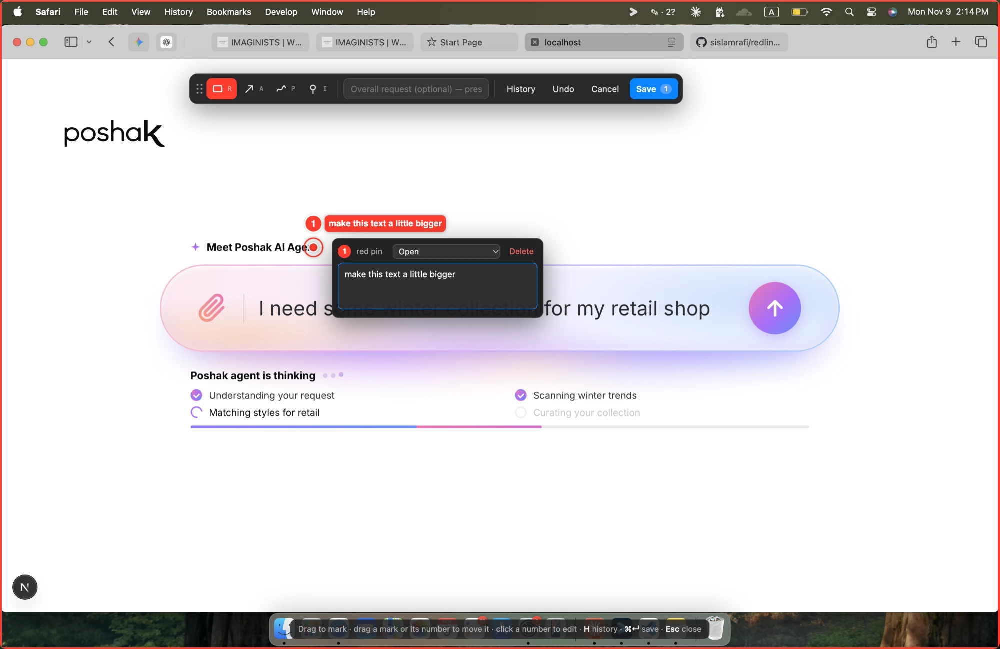
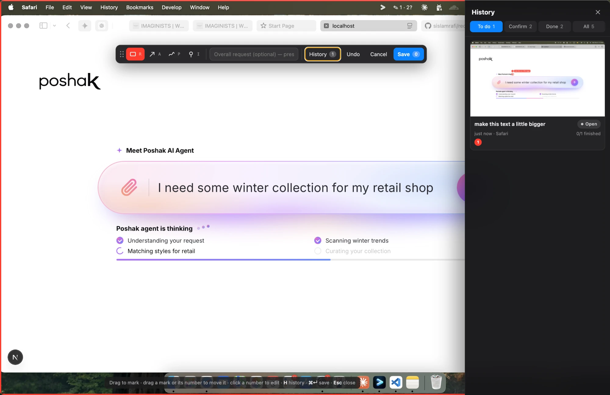
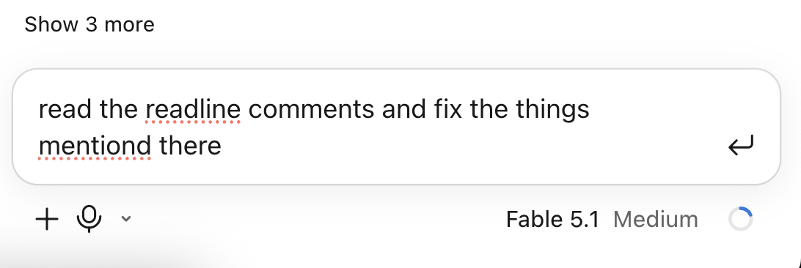

# Redline ✎

**Mark up your screen, and let your AI agent make the UI changes.**

[](LICENSE)

Redline is a small desktop app plus an [MCP](https://modelcontextprotocol.io) server.
Press a hotkey, draw boxes, arrows and pins on whatever is on screen, and write what should change.
Then tell Claude, ChatGPT, Antigravity or any MCP-capable agent *"apply my latest Redline"*. The agent gets
the annotated screenshot, a zoomed crop of every mark and exact coordinates. It finds the matching code,
makes the changes and reports back per mark, and you confirm each one in the app.



```
⌥⇧M / Alt+Shift+M  ──►  freeze-frame of the screen under your cursor
                        draw: Box (R) · Arrow (A) · Pen (P) · Pin (I), add a comment to each mark
                        ⌘↵ / Ctrl+Enter save   Esc cancel   ⌘Z / Ctrl+Z undo   N = overall note   H = history
                   ──►  ~/.redline/requests/<id>/
                   ──►  Redline MCP  →  agent reads the request, edits code, sets each mark to "review"
                   ──►  you click ✓ Looks good  (or ↺ Not done)
```

## Contents

- [Why](#why)
- [Features](#features)
- [Platform support](#platform-support)
- [Install](#install)
- [Run the desktop app](#run-the-desktop-app) (macOS · Windows · Linux)
- [Start automatically at login](#start-automatically-at-login)
- [Connect the MCP server](#connect-the-mcp-server) (Claude Code · Claude Desktop · ChatGPT · Codex CLI · Antigravity)
- [Using it](#using-it) (step-by-step walkthrough with screenshots)
- [MCP reference](#mcp-reference)
- [Storage layout](#storage-layout)
- [Configuration](#configuration)
- [Project structure](#project-structure)
- [Development](#development)
- [License](#license)

## Why

Describing visual tweaks in words ("the button under the subtitle, make it a bit smaller") is slow and
easy to get wrong. With Redline you point at the thing. The agent gets the picture, the location and
the context (app, window title, browser URL), so it knows exactly what you mean.

## Features

- **Global hotkey capture.** Freezes the display under your cursor, so you can annotate anything: a browser tab, a native app, a design file.
- **Four mark types:** box, arrow, freehand pen and pin. Each one is numbered, color-coded and has its own comment.
- **Output that vision models can read:** an annotated image with comments drawn in, a downscaled preview, a zoomed crop per mark, and a structured description with pixel and normalized coordinates.
- **Per-mark status tracking:** `open → in_progress → review → done`, plus `partial` and `wontfix`. Agents leave notes that you see in the app.
- **History view.** Reopen any request, move or resize marks, edit comments, confirm or reject the agent's work, or delete requests.
- **Context capture (macOS).** It records the frontmost app, window title and browser URL.
- **Local and private.** Requests are plain files on your disk. The app and the MCP server share one folder, and nothing is uploaded unless you expose the server yourself.

## Platform support

| | macOS | Windows | Linux |
| --- | --- | --- | --- |
| Capture, markup, history | ✅ tested | ✅ should work | ✅ X11 · ⚠️ Wayland (see below) |
| Global hotkeys | ✅ | ✅ | ✅ X11 · ⚠️ Wayland |
| App / window / URL context | ✅ | — | — |
| MCP server | ✅ | ✅ | ✅ |

Redline is built on Electron and developed on macOS. Windows and Linux use the same code path for
screen capture and hotkeys, but they have had less testing, so please open an issue if something breaks.
On Linux **Wayland**, screen capture goes through the desktop portal (you may see a "share screen" prompt),
and global hotkeys may not register. If they don't, bind `npm run app -- --capture` to a shortcut in your
desktop environment's keyboard settings, or log in with an X11 session.

## Install

You need [Node.js](https://nodejs.org) 18 or newer (developed on Node 24) and git.

```bash
git clone https://github.com/sislamrafi/redline.git
cd redline
npm install
```

`npm install` also downloads Electron for your OS.

## Run the desktop app

Redline runs in the background with a ✎ icon in the menu bar (macOS) or system tray (Windows and Linux).
It keeps running until you choose **Quit** from that icon, so capture is always one hotkey away.

| Action | macOS | Windows / Linux |
| --- | --- | --- |
| Mark up the screen | `⌥⇧M` | `Alt+Shift+M` |
| Open history | `⌥⇧H` | `Alt+Shift+H` |

The same commands work on every OS:

```bash
npm run app                 # start Redline in the background (tray icon + hotkeys)
npm run app -- --capture    # trigger a capture (from a launcher, script or custom shortcut)
npm run app -- --history    # open the history
npm run app -- --selftest   # render a demo request without touching the screen, then quit
```

If Redline is already running, `--capture` and `--history` are passed to the running copy,
so you can bind them to Raycast, Alfred, AutoHotkey or your desktop's custom shortcuts.

### macOS

```bash
cd ~/path/to/redline
npm run app
```

- The first capture needs **Screen Recording** permission: open System Settings → Privacy & Security → Screen Recording and allow **Electron**, or the terminal you started Redline from. Then quit and restart Redline.
- Reading the window title and browser URL may ask for **Accessibility** or **Automation** access. This is optional; capture works without it.

### Windows

In PowerShell or Command Prompt:

```powershell
cd C:\path\to\redline
npm run app
```

- No extra permission is needed for screen capture.
- If `Alt+Shift+M` clashes with another app (some keyboard layouts use `Alt+Shift` to switch language), choose another hotkey:

  ```powershell
  $env:REDLINE_HOTKEY="Control+Shift+M"; npm run app
  ```

- The tray icon may be hidden under the **^** overflow arrow in the taskbar.

### Linux

```bash
cd ~/path/to/redline
npm run app
```

- On Ubuntu 24.04 and other distros that restrict unprivileged user namespaces, Electron may stop with a sandbox error. Run it with `npm run app -- --no-sandbox`, or fix the permissions on `node_modules/electron/dist/chrome-sandbox` as the error message describes.
- GNOME doesn't show tray icons by default. Install the *AppIndicator and KStatusNotifierItem Support* extension to see the ✎ icon. The hotkeys work without it.
- On Wayland, see [Platform support](#platform-support).

## Start automatically at login

To have Redline always ready, start it when you log in. In each example, replace `/path/to/redline` with
the folder you cloned into.

### macOS: Launch Agent

Create `~/Library/LaunchAgents/com.redline.app.plist`:

```xml
<?xml version="1.0" encoding="UTF-8"?>
<!DOCTYPE plist PUBLIC "-//Apple//DTD PLIST 1.0//EN" "http://www.apple.com/DTDs/PropertyList-1.0.dtd">
<plist version="1.0">
<dict>
  <key>Label</key><string>com.redline.app</string>
  <key>ProgramArguments</key>
  <array>
    <string>/path/to/redline/node_modules/.bin/electron</string>
    <string>/path/to/redline</string>
  </array>
  <key>RunAtLoad</key><true/>
  <key>KeepAlive</key><false/>
</dict>
</plist>
```

```bash
launchctl load ~/Library/LaunchAgents/com.redline.app.plist
```

To stop it starting at login: `launchctl unload ~/Library/LaunchAgents/com.redline.app.plist`.

### Windows: Startup folder

1. Press `Win+R`, type `shell:startup` and press Enter.
2. In that folder, create `redline.vbs` with the following content. It starts Redline without leaving a console window open.

   ```vbscript
   Set sh = CreateObject("WScript.Shell")
   sh.CurrentDirectory = "C:\path\to\redline"
   sh.Run "cmd /c npm run app", 0, False
   ```

To stop it starting at login, delete `redline.vbs`.

### Linux: XDG autostart

Create `~/.config/autostart/redline.desktop`:

```ini
[Desktop Entry]
Type=Application
Name=Redline
Comment=Mark up your screen for AI agents
Exec=/path/to/redline/node_modules/.bin/electron /path/to/redline
X-GNOME-Autostart-enabled=true
```

Add `--no-sandbox` to the end of the `Exec` line if you needed it above. To stop it starting at login, delete the file.

## Connect the MCP server

The MCP server is `mcp/server.js`. It talks over **stdio** and reads the same `~/.redline` folder as the app.
Every client below needs the **absolute path** to that file:

| OS | Example path |
| --- | --- |
| macOS | `/Users/you/redline/mcp/server.js` |
| Linux | `/home/you/redline/mcp/server.js` |
| Windows | `C:/Users/you/redline/mcp/server.js` (forward slashes, or `\\` in JSON) |

> The desktop app doesn't need to be running for the MCP server to work. It only has to be running
> when you want to capture new markups.

### Claude Code

Available in every project (recommended):

```bash
claude mcp add --scope user redline -- node /absolute/path/to/redline/mcp/server.js
```

Check that it connected:

```bash
claude mcp list
```

To add it to one project only, run the command inside that project with `--scope project` instead.
This writes a `.mcp.json` file that you can commit. In the Claude desktop app's Code tab, the servers you
add with `claude mcp add` are picked up automatically.

### Claude Desktop (chat)

Open **Settings → Developer → Edit Config**, or edit the file directly:

| OS | Config file |
| --- | --- |
| macOS | `~/Library/Application Support/Claude/claude_desktop_config.json` |
| Windows | `%APPDATA%\Claude\claude_desktop_config.json` |

```json
{
  "mcpServers": {
    "redline": {
      "command": "node",
      "args": ["/absolute/path/to/redline/mcp/server.js"]
    }
  }
}
```

Fully quit and reopen Claude Desktop. The Redline tools then appear in the tools menu of the chat box.
Claude Desktop isn't available for Linux; use Claude Code there.

### ChatGPT

ChatGPT connects only to **remote** MCP servers over HTTPS. It can't start a local stdio server the way
Claude does, so you run a small bridge that serves Redline over HTTP and expose it with a tunnel.

> ⚠️ **Privacy:** a tunnel URL makes your screenshots readable by anyone who has the URL, and this bridge has
> no authentication. Only run it while you use it, keep the URL private, and stop the tunnel afterwards.

1. **Serve Redline over HTTP** with [supergateway](https://github.com/supercorp-ai/supergateway):

   ```bash
   npx -y supergateway --stdio "node /absolute/path/to/redline/mcp/server.js" \
     --outputTransport streamableHttp --port 8787
   ```

   On Windows PowerShell, put it on one line and leave out the `\`.

2. **Give it a public HTTPS URL** in a second terminal, with [cloudflared](https://developers.cloudflare.com/cloudflare-one/connections/connect-networks/downloads/) (free, no account needed for quick tunnels) or [ngrok](https://ngrok.com):

   ```bash
   cloudflared tunnel --url http://localhost:8787
   ```

   It prints a URL like `https://random-words.trycloudflare.com`.

3. **Add it in ChatGPT:** go to Settings → Apps & Connectors → Advanced, turn on **Developer mode**, then create a connector:
   - **MCP Server URL:** `https://random-words.trycloudflare.com/mcp`
   - **Authentication:** none

   Developer mode needs a paid plan, and on Business, Enterprise and Edu an admin may have to allow it.
   Menu names change from time to time; see OpenAI's help center if yours look different.

4. In a new chat, turn on the Redline connector and ask: *"Use Redline to show my latest edit request."*

ChatGPT can read your markups this way, but it can't edit the code on your computer.
To have changes applied to your code, use an agent that runs locally, such as Claude Code, Codex CLI or Antigravity.

### OpenAI Codex CLI

Codex CLI runs locally and supports stdio servers directly. Add this to `~/.codex/config.toml`
(`%USERPROFILE%\.codex\config.toml` on Windows):

```toml
[mcp_servers.redline]
command = "node"
args = ["/absolute/path/to/redline/mcp/server.js"]
```

Or from the terminal:

```bash
codex mcp add redline -- node /absolute/path/to/redline/mcp/server.js
```

### Google Antigravity

1. In the Agent panel, open the **⋮** menu → **MCP Servers** → **Manage MCP Servers** → **View raw config**.
   This opens `mcp_config.json`. Depending on your version, it's at `~/.gemini/config/mcp_config.json` or
   `~/.gemini/antigravity/mcp_config.json`. On Windows, `~` is `%USERPROFILE%`.
2. Add Redline under `mcpServers`:

   ```json
   {
     "mcpServers": {
       "redline": {
         "command": "node",
         "args": ["/absolute/path/to/redline/mcp/server.js"]
       }
     }
   }
   ```

3. Save the file and click **Refresh** in Manage MCP Servers. Redline's four tools should be listed.

To add Redline to one workspace only, put the same JSON in `.agents/mcp_config.json` in that project.

### Other MCP clients

Cursor, Windsurf, VS Code (Copilot), Cline, Zed and others use the same `command` / `args` entry.
Look for "MCP servers" in their settings and point it at `node /absolute/path/to/redline/mcp/server.js`.

## Using it

This walkthrough follows one real request: making a heading on a web page a little bigger.

### Step 1: Add the Redline MCP to Claude (one-time setup)

Your agent can only see your markups after the Redline MCP is added. Do this once, before your first request:

```bash
claude mcp add --scope user redline -- node /absolute/path/to/redline/mcp/server.js
```

```bash
claude mcp list        # should show: redline … ✓ Connected
```

For Claude Desktop, ChatGPT, Codex CLI or Antigravity, see [Connect the MCP server](#connect-the-mcp-server).
Also make sure the desktop app is running (`npm run app`); look for the ✎ icon in the menu bar or tray.

### Step 2: Mark up the screen

Open the page or app you want to change and press **⌥⇧M** (macOS) or **Alt+Shift+M** (Windows/Linux).
The screen freezes and the Redline toolbar appears at the top.

1. Choose a tool: **Box (R)**, **Arrow (A)**, **Pen (P)** or **Pin (I)**.
2. Click or drag on the thing you want changed. A numbered mark appears.
3. Type what should change in the comment box, for example *"make this text a little bigger"*.
   Set the status there too, or delete the mark.
4. Add more marks if you need them. To give the whole request a note, type it in the
   **Overall request** field in the toolbar, or press **N**.
5. Click **Save**, or press **⌘↵** / **Ctrl+Enter**. Press **Esc** to cancel.


### Step 3: Check it in the history

Press **⌥⇧H** / **Alt+Shift+H**, or click **History** in the toolbar, to see every request.
The tabs sort them by where they stand:

| Tab | Meaning |
| --- | --- |
| **To do** | New requests, and requests the agent is still working on |
| **Confirm** | The agent says it's finished; waiting for you to check |
| **Done** | You confirmed the result |
| **All** | Everything |

Each card shows the screenshot, your first comment, the app it came from, and how many marks are finished.
Click a card to reopen the request and edit it.



### Step 4: Ask Claude to apply it

Open Claude in the project that contains that UI (here, the website's code) and ask in plain words:

> read the Redline comments and fix the things mentioned there

You can also say *"apply my latest Redline"*, or, in Claude Code, run `/mcp__redline__apply_latest`.



Claude then:

1. calls `get_edit_request` and receives the annotated screenshot, a zoomed crop of each mark and its coordinates;
2. finds the matching code from the visible text, the page URL and the layout, and makes the change;
3. calls `update_edit_request_status` to move each mark to **Waiting for confirmation**, with a note naming the file it changed.

### Step 5: Confirm the result

Reload the page and check the change. In the History, the request is now under **Confirm**.
Open it, click a mark, and choose **✓ Looks good** (or **Confirm all**). If it isn't right, choose **↺ Not done**
and add a comment saying what's still wrong. The mark goes back to **To do**, and the next time you ask,
Claude picks it up again.

## MCP reference

| Tool | What it does |
| --- | --- |
| `list_edit_requests` | Lists requests, newest first. Filter by `active` (the default), `open`, `in_progress`, `partial`, `review`, `done`, `wontfix` or `all`. |
| `get_edit_request` | Returns the annotated preview, a crop per unfinished mark and a structured description. `id` defaults to `latest`. Optional: `include_crops`, `include_original`, `mark_in_progress`. |
| `update_edit_request_status` | Sets the status of individual marks and/or the whole request, with notes the user sees. |
| `delete_edit_request` | Permanently deletes a request and its images. Use it only when the user asks. |

| Prompt | What it does |
| --- | --- |
| `apply_latest` | Fetches the latest request, implements each unfinished mark in the current codebase and reports per mark. |

Agents set finished marks to **`review`**, not `done`. You confirm them in the app.
If you edit or move a mark, it goes back to `open`, so the next agent picks it up again.

## Storage layout

```
~/.redline/requests/<id>/
  request.json      marks (pixel + normalized coords), comments, status, app/window/URL context
  screenshot.png    untouched original
  annotated.png     numbered, color-coded marks with comment callouts (full resolution)
  preview.png       the same image, ≤1600px wide (what the MCP server sends)
  crops/mark-N.png  zoomed crop around each mark
  prompt.md         a description that ties each #N and its color to a location
```

On Windows, `~` is your user folder (`C:\Users\you\.redline`).

## Configuration

| Variable | Default | Purpose |
| --- | --- | --- |
| `REDLINE_HOTKEY` | `Alt+Shift+M` | Capture hotkey ([Electron accelerator](https://www.electronjs.org/docs/latest/api/accelerator) syntax, e.g. `CommandOrControl+Shift+2`) |
| `REDLINE_HISTORY_HOTKEY` | `Alt+Shift+H` | History hotkey |
| `REDLINE_HOME` | `~/.redline` | Storage folder, used by both the app and the MCP server |

If you change `REDLINE_HOME`, set it for the MCP server too: add `"env": { "REDLINE_HOME": "..." }`
to the server entry in your MCP config.

An existing `~/.annotation-mcp` folder from older versions is moved to `~/.redline` automatically.

## Project structure

```
app/
  main.js          Electron tray app: hotkeys, screen capture, windows, IPC
  preload.cjs      bridge between the renderer and main process
  renderer/        markup editor and history UI (HTML/CSS/JS)
mcp/server.js      MCP server (stdio)
shared/store.js    on-disk store and status logic, shared by the app and the server
scripts/
  mcp-smoke.js     end-to-end smoke test against the MCP server
  mcp-call.js      call one MCP tool from the CLI: node scripts/mcp-call.js <tool> '<json>' [outDir]
```

## Development

```bash
npm run mcp                   # run the MCP server on stdio
node scripts/mcp-smoke.js     # list tools, fetch the latest request and update its status
```

The smoke test changes the status of your latest request to `done`. Point `REDLINE_HOME` at a scratch
folder if you don't want that.

Issues and pull requests are welcome.

## License

Redline is released under the [MIT License](LICENSE). © 2026 S Islam Rafi.
